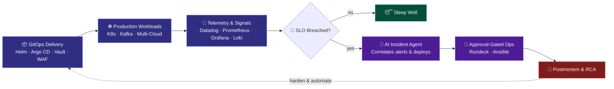

<!-- ═══════════════════════════════ HERO ═══════════════════════════════ -->
<div align="center">
  <picture>
    <source media="(prefers-color-scheme: dark)" srcset="./assets/hero-dark.svg" />
    <source media="(prefers-color-scheme: light)" srcset="./assets/hero-light.svg" />
    
  </picture>
</div>

<div align="center">
  <a href="https://git.io/typing-svg">
    
  </a>
</div>

<div align="center">
  <a href="https://linkedin.com/in/fabianimv"></a>
  <a href="https://fabianimv.github.io/portfolio"></a>
  <a href="mailto:fabianignaciomv@gmail.com"></a>
  <a href="https://pypi.org/project/madeleine-mcp/"></a>
  
  <br/><br/>
  
  <br/>
  <sub>🚨 <b>Severity: awesome.</b> You've been paged — welcome to my profile!</sub>
</div>

<br/>

> **Site Reliability Engineer** with **4+ years** operating mission-critical systems, currently at **Banco Falabella** (SRE automation & scalability cell). I run services on **Kubernetes** with **Helm** and **Argo CD**, automate operations in **Python** and **Ansible**, manage multi-cloud infrastructure with **Terraform**, and work incidents from alert to postmortem. Before that, three years running observability for Fortune 500 clients. I also publish open-source Python & MCP tools. _I like to keep the lights on._

---

<!-- ═══════════════════════════════ STATUS PAGE ═══════════════════════════════ -->
## 🟢 `fabian.prod` — System Status

| Service | Capabilities & Telemetry | Status |
| :-- | :-- | :--: |
| ☸️ **Kubernetes & GitOps** | Helm · Argo CD · Argo Workflows · HashiCorp Vault · Cloudflare WAF |  |
| 🔭 **Observability & SRE** | Datadog · Prometheus · Grafana · Loki · SLI/SLO · Kafka (Confluent) |  |
| 🤖 **AI-Assisted Ops & Automation** | LLM incident correlation · Approval-gated Rundeck/Ansible · Python · MCP |  |
| ☁️ **Multi-Cloud & IaC** | AWS · GCP · Azure · Terraform · CloudFormation · Cloudflare |  |
| 📦 **Open Source & MCP** | Published Python MCP servers on PyPI & Official MCP Registry |  |
| ☕ **Coffee Saturation** | Refill scheduled, no action needed · `< 90%` |  |

---

<!-- ═══════════════════════════════ MANIFEST ═══════════════════════════════ -->
## 🧑‍💻 `$ kubectl describe engineer fabian`

```yaml
apiVersion: reliability.fabian.dev/v1
kind: SiteReliabilityEngineer
metadata:
  name: fabian-munoz
  namespace: santiago-chile
  labels:
    role: sre
    experience: 4y+
    availability: remote-and-international-travel
spec:
  currentRole: Site Reliability Engineer @ Banco Falabella (Oct 2025 – present)
  previousRole: Site Reliability Engineer @ Innfinit SpA — Fortune 500 Consultancy (Nov 2022 – Oct 2025)
  education:
    - Computer Engineering (Ingeniería en Informática), Duoc UC · 2025
    - Programming Analyst, Duoc UC · 2024
  languages:
    - Spanish (native)
    - English (professional working proficiency)
  focus:
    - GitOps & Kubernetes Operations (Helm, Argo CD, Vault)
    - High-Availability Observability & SLI/SLO Engineering
    - AI-Assisted Incident Response & Approval-Gated Automation
    - Multi-Cloud Infrastructure as Code (Terraform)
status:
  phase: Running
  motto: "I like to keep the lights on."
```

---

<!-- ═══════════════════════════════ ARCHITECTURE ═══════════════════════════════ -->
## 🧭 How I Keep Systems Reliable



---

<!-- ═══════════════════════════════ PRODUCTION IMPACT ═══════════════════════════════ -->
## 🏗️ Production Impact

> ### 🤖 AI-Assisted Incident & Release Platform · `Banco Falabella`
>     
>
> Co-building an AI-assisted incident platform where an LLM agent correlates alerts and deployments across Datadog, Loki, and cloud, proposing approval-gated Rundeck remediation jobs. Also built a multi-agent issue-to-Argo CD release pipeline piloted on self-hosted open-weight models.

> ### ☸️ GitOps & MCP in Production · `Banco Falabella`
>    
>
> Operating Kubernetes services and automated ETL workloads under GitOps with Helm and Argo CD. Took an internal Python MCP server from proof of concept to a hardened production service: build pipeline, Helm chart, Argo CD, Vault secrets, and Cloudflare WAF.

> ### ⚡ High-Availability Streaming, DR & IaC · `Banco Falabella`
>    
>
> Operating observability for Kafka event streaming in high-availability transaction processing, cross-site disaster recovery planning, migrating Rundeck automations to Ansible Automation Platform, and managing Datadog, GCP, Azure, and Cloudflare with Terraform.

> ### 🌎 Fortune 500 Observability at Scale · `Innfinit SpA`
>    
>
> Three years delivering reliability and observability across **Liberty Mutual US** (RCA, postmortems, Splunk → Datadog migration), **Sovos** _(observability lead — Prometheus Operator & Grafana Cloud across dev/QA/prod)_, **Red Salud** (HA Prometheus/Grafana/Loki + Slack/Teams/PagerDuty), and **Liberty Andes** (3-country Datadog-as-Code with Terraform).

---

<!-- ═══════════════════════════════ OPEN SOURCE ═══════════════════════════════ -->
## 🚀 Open Source & Python Projects

| Project | Description | Links |
| :-- | :-- | :--: |
| 🧠 **[madeleine](https://github.com/fabianimv/madeleine)** | MCP server in Python that recalls related memories for AI agents from context such as place or time. Published on **PyPI** & the **Official MCP Registry**. | [](https://github.com/fabianimv/madeleine)<br/>[](https://pypi.org/project/madeleine-mcp/) |
| 🎙️ **[Voice Coach MCP](https://github.com/fabianimv/voice-coach-mcp)** | Local Python MCP server for pronunciation and speaking practice with on-device audio analysis. Published on **PyPI**. | [](https://github.com/fabianimv/voice-coach-mcp)<br/>[](https://pypi.org/project/voice-coach-mcp/) |
| 🎵 **[Setlist to YouTube Music](https://github.com/fabianimv/automated-ytmusic-playlist-creator)** | FastAPI & React app with OAuth, background jobs, Docker, GitHub Actions CI, and **240+ tests**. | [](https://github.com/fabianimv/automated-ytmusic-playlist-creator) |

---

<!-- ═══════════════════════════════ TECH STACK ═══════════════════════════════ -->
## ⚡ Technical Skills

<div align="center">
  
</div>

<br/>

| Domain | Stack |
| :-- | :-- |
| **Languages & Automation** | `Python` · `Bash` · `Ansible Automation Platform` · `Rundeck` · `GitHub Actions` · `GitLab CI` |
| **Platforms & GitOps** | `Linux` · `Kubernetes` · `Helm` · `Argo CD` · `Argo Workflows` · `Docker` · `HashiCorp Vault` |
| **Cloud & IaC** | `AWS` · `Azure` · `GCP` · `Terraform` · `CloudFormation` · `Cloudflare` |
| **Observability & Incidents** | `Datadog` · `Prometheus` · `Grafana` · `Loki` · `CloudWatch` · `Langfuse` · `SLI/SLO` · `Postmortems` |
| **Data & Messaging** | `Apache Kafka (Confluent)` · `PostgreSQL` |

---

<!-- ═══════════════════════════════ CERTIFICATIONS ═══════════════════════════════ -->
## 🏅 Certifications & Courses

<div align="center">
  
  
  
  
  
  <br/>
  
  
</div>

---

<!-- ═══════════════════════════════ TELEMETRY ═══════════════════════════════ -->
## 📈 Telemetry

<div align="center">
  <picture>
    <source media="(prefers-color-scheme: dark)" srcset="https://github-readme-activity-graph.vercel.app/graph?username=FabianIMV&custom_title=Contribution%20Metrics&bg_color=0B0F19&color=A855F7&line=A855F7&point=FFFFFF&area_color=8B5CF6&area=true&hide_border=true"/>
    <source media="(prefers-color-scheme: light)" srcset="https://github-readme-activity-graph.vercel.app/graph?username=FabianIMV&custom_title=Contribution%20Metrics&theme=minimal&area=true&hide_border=true"/>
    
  </picture>
</div>

<div align="center">
  <picture>
    <source media="(prefers-color-scheme: dark)" srcset="https://raw.githubusercontent.com/FabianIMV/FabianIMV/output/github-contribution-grid-snake-dark.svg"/>
    <source media="(prefers-color-scheme: light)" srcset="https://raw.githubusercontent.com/FabianIMV/FabianIMV/output/github-contribution-grid-snake.svg"/>
    
  </picture>
  <br/>
  <sub>🐍 A snake eating my contributions — the only acceptable kind of data loss.</sub>
</div>

---

<!-- ═══════════════════════════════ ON-CALL ═══════════════════════════════ -->
## 📟 On-Call Runbook

<details>
<summary><b>🚨 Need an SRE? Click to open the runbook</b></summary>

<br/>

```bash
# Step 1 — Identify the issue
$ echo "Need reliable K8s, clean observability, or AI-assisted ops"

# Step 2 — Page the engineer
$ page --to "Fabián Muñoz" \
       --severity "let's-talk" \
       --channel https://linkedin.com/in/fabianimv \
       --portfolio https://fabianimv.github.io/portfolio \
       --fallback fabianignaciomv@gmail.com

# Step 3 — Resolution
✔ GitOps & IaC automated
✔ SLOs defined & alert noise cut
✔ Incident response accelerated
✔ Lights stay on
```

</details>

<br/>

<div align="center">
  <h3>💬 Let's connect and build reliable systems together</h3>
  <a href="https://linkedin.com/in/fabianimv"></a>
  <a href="https://fabianimv.github.io/portfolio"></a>
  <a href="mailto:fabianignaciomv@gmail.com"></a>
</div>

<br/>

<!-- ═══════════════════════════════ FOOTER ═══════════════════════════════ -->
<div align="center">
  <picture>
    <source media="(prefers-color-scheme: dark)" srcset="./assets/footer-dark.svg" />
    <source media="(prefers-color-scheme: light)" srcset="./assets/footer-light.svg" />
    
  </picture>
</div>
